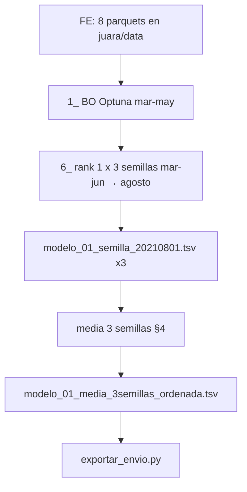

# Entrega final — experimento `04py-00`

Documentación operativa para reproducir el experimento usado como **entrega final** de la competencia: BO Optuna (`04py`), **mejor trial** (rank BO **01**), [`6_prediccion_agosto_top20_semillas.py`](00/6_prediccion_agosto_top20_semillas.py) con **3 semillas** (sin `4_`/`5_`) y exportación de CSV de envíos.

Referencias generales: [`README.md`](README.md), [`../README.md`](../README.md), [`../common/seleccion_envios.md`](../common/seleccion_envios.md), [`../../fe/nota.md`](../../fe/nota.md).

## Resumen

| Concepto | Valor |
|----------|--------|
| Intento / iteración | `04py` / `00` |
| `experiment_id` | `04py-00` ([`00/_bootstrap.py`](00/_bootstrap.py)) |
| Features | 8 capas parquet (join en [`../common/layers.py`](../common/layers.py)) |
| BO | Optuna, maximizar PR-AUC temporal mar–may (`SEMILLA_PRIMIGENIA=427417` en script `1_`) |
| HP para agosto | Rank **1** de `BO_log.txt` (mejor trial; sin `top20_hiperparametros.tsv` del `4_`) |
| Agosto | Script **`6_`**: mar–jun → `foto_mes=202108`, `COMPE1_AGOSTO_RANKS=1`, `COMPE1_N_SEMILLAS_PRIMOS=3` |
| Scripts `4_` / `5_` | **No ejecutados** (falta de tiempo) |
| TSV para envío | `modelo_01_media_3semillas_ordenada.tsv` (véase §4; equivalente numérico a `prediccion_agosto_media_ordenada.tsv` del `6_` con 3 semillas) |
| Semillas | `114847`, `178693`, `431621` (`semillas_primos(3, semilla_primigenia)`) |
| Export CSV | [`../exportar_envio.py`](../exportar_envio.py) |

### Alcance real de la entrega

1. **`1_bayesiana_lightgbm.py`** — BO y `BO_log.txt` / `PARAM.yml`.
2. **`6_prediccion_agosto_top20_semillas.py`** — un solo rank BO (**top 1**), **3** semillas primo; **sin** `4_` ni `5_` (no hay `ganador.yml`; el `6_` toma HP del `BO_log.txt`).
3. Media de `prob` sobre esas 3 corridas; ranking de envío en `modelo_01_media_3semillas_ordenada.tsv` (§4).
4. **`exportar_envio.py`** — varios cortes `N`.

El protocolo completo (`4_` → `5_` → `6_` con 10 semillas y rank vía holdout) queda en §7 como referencia.



## 1. Prerrequisitos

1. Clonar el repositorio y colocar el dataset crudo según [`../../fe/nota.md`](../../fe/nota.md) en `juara/data/`.
2. Entorno Python del proyecto:

```bash
cd juara
uv sync
```

3. Generar `competencia_01_clean_v1.parquet` si no existe (cadena completa desde crudo: ver [`../README.md`](../README.md#parquets-requeridos-y-generación-fe)).

4. Tras regenerar parquets FE, verificar el join del target:

```bash
uv run python compe1/common/verify_join_target.py
```

## 2. Feature engineering (04py)

Requisito: `juara/data/competencia_01_clean_v1.parquet`. Desde `juara/`:

```bash
uv run python fe/build_competencia_nocontinuas_v1.py
uv run python fe/build_competencia_nocontinuas_v1_lag1.py
uv run python fe/build_competencia_nocontinuas_v1_lag2.py
uv run python fe/build_rankings_v1.py
uv run python fe/build_rankings_v1_lag1.py
uv run python fe/build_rankings_v1_lag2.py
uv run python fe/build_rankings_v1_delta1.py
uv run python fe/build_rankings_v1_delta2_v2.py
```

Capas consumidas por `04py` (orden de join): nocontinuas + lag1/lag2; rankings + lag1/lag2 + delta1 + `rankings_v1_delta2_v2.parquet`.

## 3. Modelado — camino de la entrega

Todos los comandos se ejecutan desde `juara/`. Artefactos bajo `juara/compe1/04py-00/resultados/`.

### 3.1 Bayesian optimization

```bash
uv run python compe1/04py/00/1_bayesiana_lightgbm.py
```

- **Salida:** `bo/optuna.db`, `bo/BO_log.txt`, `bo/PARAM.yml`.
- **Opcional:** `COMPE1_BO_ITER`; `COMPE1_BO_EXPORT_AT_LAST_COMPLETE=1`.

### 3.2 Agosto (`6_`, rank 1 × 3 semillas)

El `6_` lee hiperparámetros del **`BO_log.txt`** (primeras filas con columna `rank`) si no existe `estudio/top20_bo_semillas/top20_hiperparametros.tsv`.

PowerShell:

```powershell
cd juara
$env:COMPE1_AGOSTO_RANKS = "1"
$env:COMPE1_N_SEMILLAS_PRIMOS = "3"
uv run python compe1/04py/00/6_prediccion_agosto_top20_semillas.py
```

Bash:

```bash
export COMPE1_AGOSTO_RANKS=1
export COMPE1_N_SEMILLAS_PRIMOS=3
uv run python compe1/04py/00/6_prediccion_agosto_top20_semillas.py
```

**Salida en `agosto/`:**

- `modelo_01_<semilla>_20210801.tsv` por cada semilla
- `prediccion_agosto_media.tsv`, `prediccion_agosto_media_ordenada.tsv` (media sobre las **3** semillas)
- `meta.yml` (`ranks_bo: [1]`, `n_semillas_primos: 3`, `semillas_train: [...]`)

Opcional: `2_produccion_lightgbm.py` (holdout junio con mejor HP de `PARAM.yml`; no alimenta el CSV de envío).

## 4. Promedio de probabilidades y TSV de envío

En la entrega el corte de competencia usó el nombre **`modelo_01_media_3semillas_ordenada.tsv`**. Con `COMPE1_N_SEMILLAS_PRIMOS=3`, las probabilidades coinciden con `prediccion_agosto_media_ordenada.tsv` del `6_`; §4 solo renombra/agrega el archivo esperado por el flujo de exportación documentado.

Semillas (orden del `6_` con `semilla_primigenia` de `PARAM.yml`):

- `114847`, `178693`, `431621`

Reproducir el TSV con nombre de entrega (desde `juara/`):

```bash
uv run python -c "
from pathlib import Path
import polars as pl

out = Path('compe1/04py-00/resultados/agosto')
aniomes = '20210801'
semillas = (114847, 178693, 431621)
rank = 1

pieces = []
for s in semillas:
    p = out / f'modelo_{rank:02d}_{s}_{aniomes}.tsv'
    if not p.is_file():
        raise FileNotFoundError(p)
    pieces.append(pl.read_csv(p, separator='\t').select('numero_de_cliente', 'foto_mes', 'prob'))

tb = (
    pl.concat(pieces, how='vertical')
    .group_by('numero_de_cliente', 'foto_mes')
    .agg(pl.col('prob').mean().alias('prob'))
)
tb.write_csv(out / 'modelo_01_media_3semillas.tsv', separator='\t')

tb_ord = tb.sort('prob', descending=True).with_columns(
    pl.arange(1, tb.height + 1).alias('orden')
)
tb_ord.write_csv(out / 'modelo_01_media_3semillas_ordenada.tsv', separator='\t')
print('OK', out / 'modelo_01_media_3semillas_ordenada.tsv')
"
```

Alternativa: usar directamente `prediccion_agosto_media_ordenada.tsv` como `--tsv` en `exportar_envio.py`.

## 5. CSV de envíos

Herramienta: [`../exportar_envio.py`](../exportar_envio.py).

- **TSV de entrada:** `compe1/04py-00/resultados/agosto/modelo_01_media_3semillas_ordenada.tsv`
- **Corte:** primeros `--n` clientes por columna `orden`
- **Nombre del CSV:** `{YYYYMMDDHHMMSS}_{n}env_rank01_exp04py-00.csv`
- **Formato:** una columna `numero_de_cliente`, sin encabezado, LF

```bash
uv run python compe1/exportar_envio.py \
  --tsv compe1/04py-00/resultados/agosto/modelo_01_media_3semillas_ordenada.tsv \
  --n 11000
```

Tamaños generados en la entrega (referencia): **10000–12500** (paso 500).

```powershell
cd juara
$tsv = "compe1/04py-00/resultados/agosto/modelo_01_media_3semillas_ordenada.tsv"
10000, 10500, 11000, 11500, 12000, 12500 | ForEach-Object {
  uv run python compe1/exportar_envio.py --tsv $tsv --n $_
}
```

## 6. Checklist de artefactos de entrega

| Artefacto | Ubicación |
|-----------|-----------|
| BO | `04py-00/resultados/bo/` |
| Predicciones por semilla | `agosto/modelo_01_114847_20210801.tsv`, `..._178693_...`, `..._431621_...` |
| Metadatos | `agosto/meta.yml` |
| Ranking para corte | `agosto/modelo_01_media_3semillas_ordenada.tsv` |
| Envíos | `agosto/*_env_rank01_exp04py-00.csv` |

## 7. Pipeline completo del repo (no usado en la entrega)

```bash
uv run python compe1/04py/00/2_produccion_lightgbm.py
uv run python compe1/04py/00/4_produccion_top20_bo_semillas.py
uv run python compe1/04py/00/5_analisis_top20_bo_semillas.py
uv run python compe1/04py/00/6_prediccion_agosto_top20_semillas.py
```

Sin `COMPE1_AGOSTO_RANKS` / `COMPE1_N_SEMILLAS_PRIMOS`, el `6_` de `04py` usa por defecto rank **3** (fallback sin `ganador.yml`) y **10** semillas.

Alternativa sin holdout: [`7_prediccion_agosto_bo_topN_semillas.py`](00/7_prediccion_agosto_bo_topN_semillas.py) con `COMPE1_BO_TOP_N` (no fue el script de la entrega).

## 8. Reproducción en VM (opcional)

```bash
export JUARA_GCS_BUCKET=juarajuangabriel_buckito2026
export COMPE1_AGOSTO_RANKS=1
export COMPE1_N_SEMILLAS_PRIMOS=3
cd juara
uv run python compe1/04py/00/1_bayesiana_lightgbm.py --vm
uv run python compe1/04py/00/6_prediccion_agosto_top20_semillas.py --vm
```
