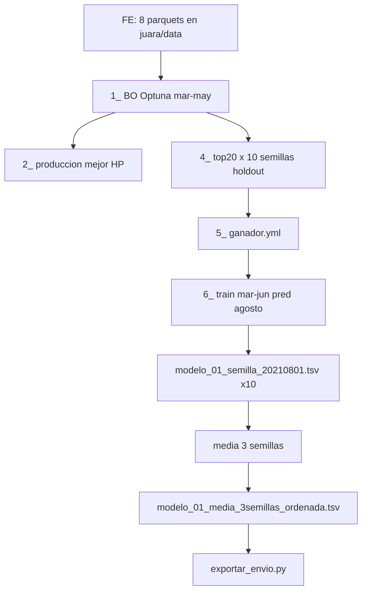

# Entrega final — experimento `04py-00`

Documentación operativa para reproducir desde cero el experimento usado como **entrega final** de la competencia: pipeline `04py`, rank BO **01**, predicción agosto 202108, **promedio de probabilidades sobre 3 semillas** y exportación de CSV de envíos.

Referencias generales: [`README.md`](README.md), [`../README.md`](../README.md), [`../common/seleccion_envios.md`](../common/seleccion_envios.md), [`../../fe/nota.md`](../../fe/nota.md).

## Resumen

| Concepto | Valor |
|----------|--------|
| Intento / iteración | `04py` / `00` |
| `experiment_id` | `04py-00` ([`00/_bootstrap.py`](00/_bootstrap.py)) |
| Features | 8 capas parquet (join en [`../common/layers.py`](../common/layers.py)) |
| BO | Optuna, maximizar PR-AUC temporal mar–may (`SEMILLA_PRIMIGENIA=427417` en script `1_`) |
| Holdout offline | Junio 2021; top-20 trials × 10 semillas primo |
| Rank usado en agosto | **1** (`ranks_bo: [1]` en `meta.yml`) |
| TSV para envío | `modelo_01_media_3semillas_ordenada.tsv` (no `prediccion_agosto_media_ordenada.tsv`) |
| Semillas en la media de envío | `114847`, `178693`, `431621` |
| Export CSV | [`../exportar_envio.py`](../exportar_envio.py) |

El script `6_prediccion_agosto_top20_semillas.py` también escribe `prediccion_agosto_media.tsv` (media sobre **10** semillas × rank ganador). La entrega final aplicó un paso adicional: media de **3** TSV por semilla del rank 01 antes de cortar clientes.



## 1. Prerrequisitos

1. Clonar el repositorio y colocar el dataset crudo según [`../../fe/nota.md`](../../fe/nota.md) en `juara/data/`.
2. Entorno Python del proyecto:

```bash
cd juara
uv sync
```

3. Generar `competencia_01_clean_v1.parquet` si no existe (cadena completa desde crudo: ver [`../README.md`](../README.md#parquets-requeridos-y-generación-fe)).

4. Tras regenerar parquets FE, verificar el join del target:

```bash
uv run python compe1/common/verify_join_target.py
```

## 2. Feature engineering (04py)

Requisito: `juara/data/competencia_01_clean_v1.parquet`. Desde `juara/`:

```bash
uv run python fe/build_competencia_nocontinuas_v1.py
uv run python fe/build_competencia_nocontinuas_v1_lag1.py
uv run python fe/build_competencia_nocontinuas_v1_lag2.py
uv run python fe/build_rankings_v1.py
uv run python fe/build_rankings_v1_lag1.py
uv run python fe/build_rankings_v1_lag2.py
uv run python fe/build_rankings_v1_delta1.py
uv run python fe/build_rankings_v1_delta2_v2.py
```

Capas consumidas por `04py` (orden de join): nocontinuas + lag1/lag2; rankings + lag1/lag2 + delta1 + `rankings_v1_delta2_v2.parquet`.

## 3. Pipeline de modelado

Todos los comandos se ejecutan desde `juara/`. Artefactos bajo `juara/compe1/04py-00/resultados/`.

```bash
uv run python compe1/04py/00/1_bayesiana_lightgbm.py
uv run python compe1/04py/00/2_produccion_lightgbm.py
uv run python compe1/04py/00/4_produccion_top20_bo_semillas.py
uv run python compe1/04py/00/5_analisis_top20_bo_semillas.py
uv run python compe1/04py/00/6_prediccion_agosto_top20_semillas.py
```

### Script `1_bayesiana_lightgbm.py`

- **Entrada:** parquets unidos (mar–jun en datos; BO solo mar–may).
- **Salida:** `bo/optuna.db`, `bo/BO_log.txt`, `bo/PARAM.yml` (`campos_buenos`, cortes, mejor trial).
- **Opcional:** `COMPE1_BO_ITER` (default `150`); `COMPE1_BO_EXPORT_AT_LAST_COMPLETE=1` para exportar todos los trials COMPLETE del SQLite sin nuevos trials.

### Script `2_produccion_lightgbm.py`

- **Entrada:** mejor HP en `PARAM.yml`.
- **Salida:** `produccion/` (un modelo, holdout junio). Referencia; no alimenta directamente el CSV de envío.

### Script `4_produccion_top20_bo_semillas.py`

- **Entrada:** top 20 filas de `BO_log.txt`.
- **Salida:** `top20/rank_01/` … `rank_20/`; `estudio/top20_bo_semillas/top20_hiperparametros.tsv`, `semillas_train.txt`.
- Por rank: predicciones y cortes de ganancia **por semilla** y **prob media** en holdout (`prediccion_media.txt`, `cortes_ganancia_media.tsv`).

### Script `5_analisis_top20_bo_semillas.py`

- **Entrada:** cortes en `top20/rank_XX/`.
- **Salida:** `estudio/top20_bo_semillas/ganador.yml` (`rank_ganador`, `envios_argmax_ganador`), `ranking_por_max_holdout.tsv`, gráficos y contrastes.
- Criterio de envíos en holdout: ver [`../common/seleccion_envios.md`](../common/seleccion_envios.md).

### Script `6_prediccion_agosto_top20_semillas.py`

- **Entrada:** `ganador.yml` (usa `rank_ganador`; en la entrega resultó **rank 1**), `PARAM.yml`, datos mar–jun + agosto `202108`.
- **Entrenamiento:** mar–jun; **predicción:** `foto_mes=202108`.
- **Salida en `agosto/`:**
  - `modelo_01_<semilla>.txt` (LightGBM)
  - `modelo_01_<semilla>_20210801.tsv` (`numero_de_cliente`, `foto_mes`, `prob`)
  - `prediccion_agosto_media.tsv`, `prediccion_agosto_media_ordenada.tsv` (media de 10 semillas × rank usado)
  - `meta.yml`

Patrones de nombre: [`../common/agosto_artifacts.py`](../common/agosto_artifacts.py).

## 4. Promedio de probabilidades

### A) Holdout junio (rank y envíos offline)

En cada `top20/rank_XX/` el script `4_` calcula, por cliente en junio, la media de `prob` sobre las **10** semillas primo antes de ordenar y evaluar cortes (`cortes_ganancia_media.tsv`, cabecera `prob_media=10_semillas_primo`). El script `5_` elige el rank ganador y el envío argmax en holdout (`envios_argmax_ganador` en `ganador.yml`). Ese valor orienta el estudio offline; **no** obliga al mismo `N` en el CSV de competencia de agosto.

### B) Agosto — media de 3 semillas (entrega final)

Tras el script `6_`, usar los TSV por semilla del rank 01. Semillas de la entrega:

- `114847`
- `178693`
- `431621`

Comprobar que pertenecen al conjunto de 10 primos en `estudio/top20_bo_semillas/semillas_train.txt` o `agosto/meta.yml` (`semillas_train`).

Para cada cliente \(i\), con probabilidades \(p_{i,s}\) por semilla \(s \in S\), \(|S|=3\):

\[
\bar{p}_i = \frac{1}{3} \sum_{s \in S} p_{i,s}
\]

Reproducir los TSV agregados (desde `juara/`):

```bash
uv run python -c "
from pathlib import Path
import polars as pl

out = Path('compe1/04py-00/resultados/agosto')
aniomes = '20210801'
semillas = (114847, 178693, 431621)
rank = 1

pieces = []
for s in semillas:
    p = out / f'modelo_{rank:02d}_{s}_{aniomes}.tsv'
    if not p.is_file():
        raise FileNotFoundError(p)
    pieces.append(pl.read_csv(p, separator='\t').select('numero_de_cliente', 'foto_mes', 'prob'))

tb = (
    pl.concat(pieces, how='vertical')
    .group_by('numero_de_cliente', 'foto_mes')
    .agg(pl.col('prob').mean().alias('prob'))
)
tb.write_csv(out / 'modelo_01_media_3semillas.tsv', separator='\t')

tb_ord = tb.sort('prob', descending=True).with_columns(
    pl.arange(1, tb.height + 1).alias('orden')
)
tb_ord.write_csv(out / 'modelo_01_media_3semillas_ordenada.tsv', separator='\t')
print('OK', out / 'modelo_01_media_3semillas_ordenada.tsv')
"
```

## 5. CSV de envíos

Herramienta: [`../exportar_envio.py`](../exportar_envio.py).

- **TSV de entrada:** `compe1/04py-00/resultados/agosto/modelo_01_media_3semillas_ordenada.tsv`
- **Corte:** primeros `--n` clientes por columna `orden` (o por orden de filas si no hubiera `orden`)
- **Nombre del CSV:** `{YYYYMMDDHHMMSS}_{n}env_rank01_exp04py-00.csv` (hora local; `experiment_id` y `ranks_bo` desde `agosto/meta.yml` si no se pasan flags)
- **Formato:** una columna de `numero_de_cliente`, sin encabezado, sin comillas, LF, enteros ASCII

Ejemplo para un corte:

```bash
uv run python compe1/exportar_envio.py \
  --tsv compe1/04py-00/resultados/agosto/modelo_01_media_3semillas_ordenada.tsv \
  --n 11000
```

En la entrega se generaron varios tamaños de envío (referencia): **10000, 10500, 11000, 11500, 12000, 12500** (paso 500). El `N` de competencia es decisión explícita al exportar; puede coincidir o no con `envios_argmax_ganador` del holdout.

Bucle en PowerShell (mismo directorio de salida que el TSV):

```powershell
cd juara
$tsv = "compe1/04py-00/resultados/agosto/modelo_01_media_3semillas_ordenada.tsv"
10000, 10500, 11000, 11500, 12000, 12500 | ForEach-Object {
  uv run python compe1/exportar_envio.py --tsv $tsv --n $_
}
```

Cada ejecución crea un archivo nuevo con timestamp; no sobrescribe CSV existentes.

## 6. Checklist de artefactos de entrega

| Artefacto | Ubicación |
|-----------|-----------|
| Metadatos agosto | `04py-00/resultados/agosto/meta.yml` (`experiment_id`, `ranks_bo: [1]`) |
| Predicciones por semilla (3 usadas) | `agosto/modelo_01_114847_20210801.tsv`, `..._178693_...`, `..._431621_...` |
| Ranking para corte | `agosto/modelo_01_media_3semillas_ordenada.tsv` |
| Envíos competencia | `agosto/*_env_rank01_exp04py-00.csv` |
| Ganador holdout (referencia) | `estudio/top20_bo_semillas/ganador.yml` |

Los directorios `04py-00/resultados/` suelen ser locales o en GCS; no se versionan en git.

## 7. Reproducción en VM (opcional)

Con bucket y `gcloud` configurados, añadir `--vm` a cada script del pipeline. Variables y prefijos GCS: tabla en [`README.md`](README.md#vm-spot-y-gcs-vm). Guía de máquina: [`../../gce.md`](../../gce.md).

Ejemplo:

```bash
export JUARA_GCS_BUCKET=juarajuangabriel_buckito2026
cd juara
uv run python compe1/04py/00/1_bayesiana_lightgbm.py --vm
```

Repetir `--vm` en los scripts `2_`, `4_`, `5_` y `6_` para sincronizar `04py-00/resultados/` con `gs://<bucket>/compe1/04py-00/resultados/`.
